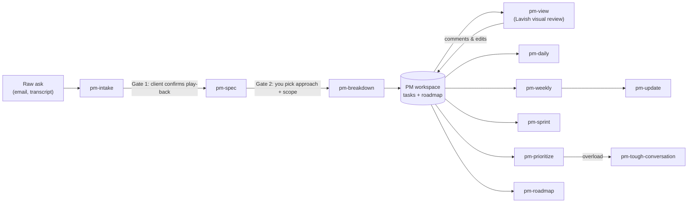

# OpenPM

**A project-management suite of agent skills for technical leads and PMs.**
OpenPM takes what your clients ask for and turns it into a living roadmap of
small, concrete tasks that tells one consistent story. It then helps you
decide what to work on today, this week, and this sprint, and helps you get
ready for difficult conversations.

The structure is inspired by OpenExec,
which uses gated, repeatable workflows. The minimalism comes from
[Ponytail](https://github.com/DietrichGebert/ponytail) and its "Ladder of
Laziness", applied here to requirements before they turn into code.

> You own the client, the relationships, and the decisions.
> The agent owns the breakdown, the success metrics, and the first drafts.

## Commands

| Command | Time scale | What it does |
|:--|:--|:--|
| `pm-init` | once / per client | Sets up your private PM workspace, your profile, and new clients |
| `pm-intake` | per request | Turns a raw client ask into a brief with open questions, a Ladder of Laziness verdict, and a **play-back message** you send to confirm you understood |
| `pm-spec` | per initiative | Writes success metrics (outcome / output / guardrail), MUST/SHOULD/OUT scope, **options for you to choose from**, stories, and a pre-mortem |
| `pm-breakdown` | per initiative | Splits the spec into atomic tasks, including *your* lead tasks, with the critical path and a capacity check, and adds milestones to the roadmap |
| `pm-view` | on demand | Visual review in browser via Lavish: plan, milestones, task board, and dependencies with live comments and editing |
| `pm-roadmap` | per client / portfolio | Builds the Now/Next/Later story and checks that tasks, milestones, and updates agree |
| `pm-prioritize` | on demand | Ranks work across all clients (WSJF-lite), flags overload, and proposes what to drop, delegate, or renegotiate |
| `pm-daily` | day | One-screen plan for the morning, plus an end-of-day `shutdown` |
| `pm-weekly` | week | Weekly review: scoreboard, client health, people to follow up with, drafted updates |
| `pm-sprint` | sprint | Sprint planning (commit up to 80% of capacity) and review/retro |
| `pm-update` | per audience | Client status update in business language, with explicit asks |
| `pm-tough-conversation` | per conversation | Prep sheet, **role-play rehearsal**, and a debrief that turns promises into tasks |

In Claude Code you run these as slash commands (`/pm-daily`). In Antigravity
and other agents that support `SKILL.md`, ask for them by name ("run
pm-daily").

## How it flows



## Install

```bash
git clone https://github.com/<you>/open-pm.git && cd open-pm
./install.sh            # symlinks skills into ~/.claude/skills and ~/.gemini/config/skills
./install.sh claude     # or only one agent
./install.sh --uninstall
```

Then open your agent anywhere and run **`pm-init`**. It creates your private
workspace (default `~/pm-workspace`), asks a few questions about how you work,
and onboards your first client.

Because the skills are symlinked, running `git pull` updates them. There is
nothing else to install: the only script is standard-library Python 3.

## Where your data lives

Your client data lives in a **separate, private workspace repo**, never in this
one. Layout:
[workspace.md](skills/pm-core/references/workspace.md). For a fictional
example, see [examples/pm-workspace](examples/pm-workspace):

```bash
python3 skills/pm-core/scripts/pm_scan.py --workspace examples/pm-workspace --today 2026-10-12
```

## Design principles

1. **Markdown is the database.** Your files are readable, diffable, and work
   with any agent. You're not locked into a tool.
2. **Agents draft; humans decide and communicate.** No agent sends a message
   or commits to a date for you.
3. **Gates before work.** Nothing gets specced until the client confirms it,
   and nothing gets broken down until you approve the approach.
4. **Code is the last resort.** Every requirement climbs the
   [Ladder of Laziness](skills/pm-core/references/ladder-of-laziness.md).
5. **Deterministic where it matters.** The task ranking and checks come from a
   script ([pm_scan.py](skills/pm-core/scripts/pm_scan.py)), not from an LLM
   guessing.
6. **Every task tells part of the story.** Every task links to a story and a
   milestone, so nothing is orphaned and scope creep shows up.

## Repo layout

```
skills/
  pm-core/        shared rules, references, templates, scanner (loaded by every other skill)
  pm-*/           one folder per command, each with a SKILL.md
examples/         fictional workspace (also the test fixture)
tests/            python3 -m unittest discover -s tests
docs/CRITIQUE.md  review of the original design notes and what changed
docs/archive/     the original (Spanish) design notes
```

## Roadmap

- [ ] Optional sync with GitHub Issues, Jira, or Linear (markdown stays the
      source of truth)
- [ ] Calendar import for `pm-daily` (meetings → available focus hours)
- [ ] `pm-review`: a Ponytail-style review of PRs and models against the spec
- [ ] Optional repo map (an "AGENTS.md cartographer") for client codebases

## License

MIT
